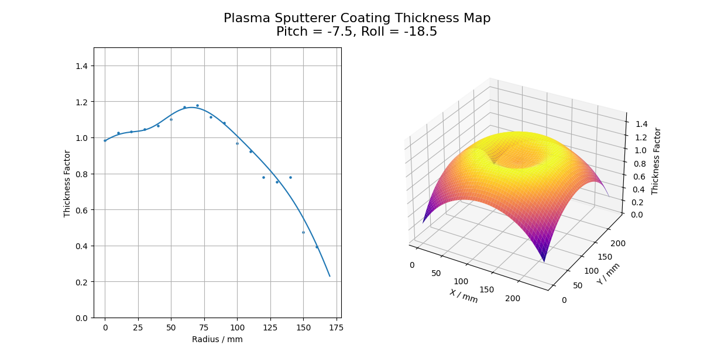

# Coating Analysis

The purpose of this repository is to model and predict the thickness profile of coatings made by plasma sputtering and electron-beam physical vapour deposition (EB-PVD), using machine-learning tools trained on experimental data.



## Method

Each experimental run is stored as a CSV file with the measured **thickness factor** (relative coating thickness) at radii from 0 to 160 mm in 10 mm steps, together with the deposition settings used for that run:

| Process | Data files | Settings (model inputs) |
|---|---|---|
| Plasma sputtering | `data/plasma/PS0589.csv` (right head), `PS0592.csv` (left head) | head pitch, head roll |
| Electron beam | `data/ebeam/EB1321.csv` (1/3 full), `EB1322.csv` (2/3 full), `EB1323.csv` (2/3 full, lower height) | crucible fullness, height |

For each process, the notebooks:

1. **Fit a model.** Radii are normalised by the maximum measured radius, and a small fully connected neural network (TensorFlow/Keras) is trained to map `(normalised radius, setting 1, setting 2)` to thickness factor:
   - Plasma: Dense(128, GELU) -> Dense(32, GELU) -> Dense(1, linear)
   - E-beam: Dense(128, GELU) -> Dense(64, GELU) -> Dense(1, linear)

   Both use the Adam optimiser with mean-squared-error loss and train for 17,500 epochs. Pre-trained models are provided in `models/` so training can be skipped.
2. **Visualise the profile.** The fitted radial profile is plotted against the data and swept over the square coating plate (dimensions from `tapejig/plate_dims.txt`) to give a 3D thickness map, assuming the profile is radially symmetric about the plate centre.
3. **Evaluate the tape targets.** The model is evaluated at the radius of each of the 180 tape targets. Targets with a thickness factor between 0.85 and 1.15 are counted as within tolerance, and the mean and standard deviation are reported.
4. **Combine the plasma heads** (plasma only). The run-time ratio of the right and left heads is optimised (SciPy Nelder-Mead) in two ways:
   - minimising the mean squared deviation from a thickness factor of 1 across the whole radial profile;
   - minimising the standard deviation of the thickness factor across the 180 targets.

## Application to the tape targetry coating jig

The tape targetry coating jig is a device that allows the efficient coating of 180 targets on a 3.6 m Kapton tape.

Using the thickness profile model, the thickness factor of each target can be estimated. A CSV file with the thickness factor of each target is written to `exports/`, and can be used for quality control.

The target positions on the plate come from `tapejig/front_data.csv` (96 targets) and `tapejig/back_data.csv` (84 targets). `tapejig/geoms.ipynb` converts these into a radius from the plate centre for each target, interleaving front and back targets in blocks of 12 to give the target numbering 1-180 along the tape.

## Repository structure

```
CoatingAnalysis/
├── plasma_tt.ipynb          # Plasma sputtering model, thickness maps, target analysis, head-ratio optimisation
├── ebeam_tt.ipynb           # Electron-beam model, thickness maps, target analysis
├── output.png               # Example figure (plasma thickness profile and map)
├── data/
│   ├── plasma/              # PS0589.csv, PS0592.csv: Radius, Thickness Factor, Pitch, Roll
│   └── ebeam/               # EB1321-EB1323.csv: Radius, Thickness Factor, Full, Height
├── models/
│   ├── plasma/              # model-230629-1238.h5 (pre-trained Keras model)
│   └── ebeam/               # ebeam-230630-1045.h5 (pre-trained Keras model)
├── exports/                 # Per-target thickness factors (Target Number, Thickness Factor)
│   ├── plasma_right_only.csv
│   ├── plasma_left_only.csv
│   ├── plasma_combined.csv
│   ├── ebeam-0.33.csv
│   ├── ebeam-0.66.csv
│   └── ebeam-0.66-lower.csv
├── tapejig/
│   ├── geoms.ipynb          # Computes target radii from the jig geometry
│   ├── front_data.csv       # x, y positions (mm) of front-side targets
│   ├── back_data.csv        # x, y positions (mm) of back-side targets
│   ├── plate_dims.txt       # Plate X and Y dimensions (mm), written by geoms.ipynb
│   ├── target_radii.csv     # Target Number, Radius (mm), written by geoms.ipynb
│   ├── target_locations.png
│   └── target_radius_distribution.png
└── LICENSE
```

## Installation

Anaconda is recommended for installing the packages needed for this project. Anaconda is a free and open-source distribution of the Python programming language for scientific computing that aims to simplify package management and deployment.

### Download and install Anaconda

Visit the [Anaconda website](https://www.anaconda.com/products/individual) and download the installer for your operating system.

### Set up the environment

After installing Anaconda, open the Anaconda Prompt from the Start menu. You may use Anaconda Navigator instead, but Anaconda Prompt is recommended for this project.

Create a new environment:

```
conda create -n coating-analysis python=3.9
```

Activate the environment:

```
conda activate coating-analysis
```

You should see the name of the environment at the beginning of the command line.

### Install the packages

```
pip install numpy pandas scipy matplotlib tensorflow==2.10 jupyter
```

TensorFlow 2.10 is pinned because the pre-trained models in `models/` are saved in Keras HDF5 (`.h5`) format.

## Usage

Start Jupyter from the repository root so the notebooks' relative paths resolve:

```
cd CoatingAnalysis
jupyter notebook
```

### 1. Target geometry (`tapejig/geoms.ipynb`)

Run this notebook from inside `tapejig/` only if the jig geometry changes. It reads `front_data.csv` and `back_data.csv` and writes `plate_dims.txt`, `target_radii.csv`, `target_locations.png` and `target_radius_distribution.png`. The outputs are already committed, so this step is optional.

### 2. Plasma sputtering (`plasma_tt.ipynb`)

- **Inputs:** `data/plasma/*.csv`, `tapejig/plate_dims.txt`, `tapejig/target_radii.csv`
- **Outputs:** `exports/plasma_right_only.csv`, `exports/plasma_left_only.csv`, `exports/plasma_combined.csv`, and optionally a new model in `models/plasma/`

Run the cells in order, but run **either** the "Train the model" cell **or** the "Load model instead" cell, not both. The "Save the model" cell writes a new timestamped `.h5` file each time it runs, so skip it when using the pre-trained model.

### 3. Electron beam (`ebeam_tt.ipynb`)

- **Inputs:** `data/ebeam/*.csv`, `tapejig/plate_dims.txt`, `tapejig/target_radii.csv`
- **Outputs:** `exports/ebeam-0.33.csv`, `exports/ebeam-0.66.csv`, `exports/ebeam-0.66-lower.csv`, and optionally a new model

Same train-or-load choice as above. Note that the "Save the model" cell currently writes to `models/plasma/` (as `ebeam-<timestamp>.h5`) rather than `models/ebeam/`. Move the file, or change the path, if you retrain.

### Adding new data

New runs can be added as CSV files with the same column layout (radius in mm, thickness factor, then the two settings in the first row). Update the file paths and training-set construction in the relevant notebook, retrain, and re-export.

## License

This project is licensed under the MIT License. See [LICENSE](LICENSE).
